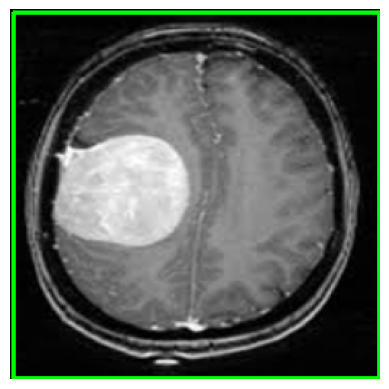

# Brain Tumor Detector (PyTorch)


[](https://www.kaggle.com/code/markkostantine/brain-tumor-detector-using-pytorch)

A CNN built from scratch in PyTorch that classifies brain MRI scans as **tumor** or **no tumor**, with a helper function that takes an uploaded image and returns the prediction.



## Dataset
[Brain MRI Images for Brain Tumor Detection](https://www.kaggle.com/search?q=Brain+MRI+Images+for+Brain+Tumor+Detection) on Kaggle: two folders of MRI slices, `yes` (tumor) and `no`. It is loaded with `torchvision.datasets.ImageFolder` and is not included in this repo.

## Model
| | |
|---|---|
| Input | 224 x 224 grayscale MRI, random horizontal flip |
| Backbone | 5 conv blocks (2 x Conv-ReLU-BatchNorm + MaxPool), channels 32, 64, 128, 256, 512 |
| Head | Global average pooling, dropout 0.5, FC 512 to 256, ReLU, dropout 0.5, FC 256 to 2 |
| Training | Adam (lr 1e-3), cross-entropy, batch size 64, 20 epochs, seed 42 |

## Results
Final-epoch **training accuracy: 95.3%** (loss 0.12).

> The model is trained and measured on the whole dataset, with no separate validation or test split. This number shows the model fits the data, not how well it generalises to new scans.

## Prediction helper
`predict_and_draw(image_bytes)` loads an image, predicts tumor / no tumor, and when a tumor is predicted draws an OpenCV bounding box taken from the image contours. The box is only a visual marker. It is not a trained tumor-localisation model.

## Limitations and next steps
- Add a proper train / validation / test split and report held-out accuracy, precision, recall and ROC-AUC.
- Use the same input size in the helper (256 x 256) as in training (224 x 224).
- Real tumor localisation needs bounding-box or segmentation labels (for example a U-Net or a YOLO model).
- Educational project. It is not a medical device and must not be used for diagnosis.

## Run it
```bash
git clone https://github.com/MarkKostantine/Brain-Tumor-Detector-PyTorch.git
cd Brain-Tumor-Detector-PyTorch
pip install -r requirements.txt
jupyter notebook brain-tumor-detector-pytorch.ipynb
```
Download the dataset from Kaggle and update the dataset path in the notebook (it points to `../input/brain-mri-images-for-brain-tumor-detection/`). Or open the [original Kaggle notebook](https://www.kaggle.com/code/markkostantine/brain-tumor-detector-using-pytorch) and run it there.
